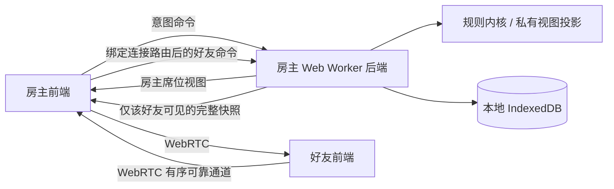

# 架构与同步协议



## 后端在哪里

后端是房主浏览器中的独立 Worker，不是远程服务。房主界面与后端使用 `postMessage`，房主与好友使用 WebRTC DataChannel。界面层将好友消息限定为三类：首次握手、操作、重新同步；好友无法请求导出、恢复、撤销或本地席位切换。

## 握手与认证

邀请 / 回应包含协议号、房间 UUID、邀请 UUID 和完整收集后的 SDP。每个好友使用一个独立连接。邀请信息使用 gzip + Base64（不支持时使用 JSON + Base64），不是加密，也不是公网目录。

好友在每个房间的 `sessionStorage` 保存一个随机席位 token，通过加密的 WebRTC 通道交给房主。房主后端按 token 认领原席位；未知 token 只能在大厅且有空席时加入。开局后不允许陌生 token 入席。相同 token 新连接会取代旧连接。每一连接只可为其绑定席位提交命令，actor 不来自网络 payload。房主 token 不传给好友。

房主就是可信权威，拥有完整状态。Worker 是代码组织和并发边界，不是防止设备持有人作弊的安全隔离。未实现公平洗牌承诺、端到端分布式持牌、匿名互联网匹配或主持人迁移。

## 操作事务

```json
{"v":1,"kind":"action","action":{"id":"random-uuid","rev":12,"type":"draw","n":2}}
```

1. 检查传输消息体积和协议类型，将通道映射到席位。
2. Worker 串行执行，通过 `actor:id` 查找去重窗口。
3. 内核要求客户端 `rev` 等于当前版本，并在克隆状态上执行、验证所有不变量。失败不提交状态。
4. 成功后增加版本、保存本地完整状态，生成每席位的独立快照。
5. 广播快照并发送 ACK。客户端丢弃旧版本快照。冲突会收到错误和新快照，需要玩家核对后重新操作。

DataChannel 使用有序可靠传输。快照包含所有该席位可见状态，不依赖客户端补齐增量事件。恢复连接后直接发送最新快照。客户端每次最多一个待确认操作，10 秒未确认会要求同步，不盲目重复执行。Worker 去重窗口保留最近 2000 个操作 ID；重启后通过提升版本使旧指令失效。

## 传输限制

- 每个逻辑消息最大 512 KiB；分成每段 6000 个 UTF-16 字符的 JSON 分片，避免超过常见 SCTP 消息限制。
- 接收端最多 90 片、最多 8 个未完成消息，超过 30 秒的半成品清除，重组后再次检查字节数。
- 使用 DataChannel 缓冲水位发送，队列最多 256 个分片。
- 房主每连接每秒最多接受 20 个逻辑消息；昵称、聊天和日志说明设长度上限。
- WebRTC 提供传输加密；不使用音视频，不请求麦克风或摄像头。

## 状态与隐私

完整状态包含牌堆、弃牌堆、结算区、每人手牌 / 装备 / 判定区、每人私看区、身份、席位 token、回合、版本和最近 250 条公开日志。

普通快照只含自己的手牌和身份、自己的私看牌、公开装备 / 判定 / 结算 / 弃牌、其他人的手牌张数、已公开身份与日志。`project()` 显式列出允许字段，不能用展开完整状态再删字段的方式实现。

复杂规则不强制：所有玩家可以执行有日志的公开区域移动和体力调整，用于人工结算不同技能。程序校验数据一致性、牌的归属与私有区域访问，不判断每次桌游动作是否符合牌面时机。同桌需要协商误操作，房主可以撤销。

## 恢复

最近牌桌保存在主持来源的 IndexedDB。导出文件用于手动备份和重新导入，校验版本、卡牌唯一性、总量、身份等。主机恢复后更新版本号，逐个重新建立连接。当前存储为单一 `latest` 槽位，不是多房间档案库；不要同时在同一来源的多个标签页主持。

完整存档属于房主私密数据，不能传给普通客户端。当前没有密码加密存档、云备份或自动迁主。
