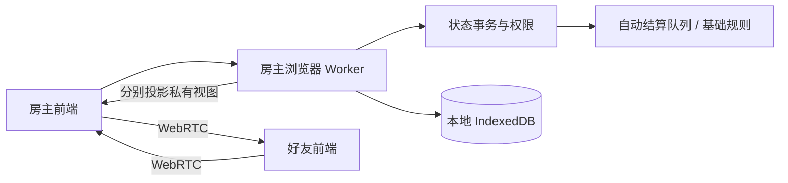

# 架构与同步

## 模块

前端只发送意图；Worker串行处理，内核在克隆状态上验证、提交，后端保存并广播各席位独立视图。没有远程游戏服务。静态托管只加载文件。

- `engine.js`：房间、选将、状态、权限、手动移动、迁移和投影。
- `rules.js`：自动队列、无懈链、杀闪/决斗/借刀/火攻/五谷响应、伤害/濒死/死亡、判定、拼点、回合。
- `skills.js`：技能触发、主动成本、分支选择、翻面/标记/获得与失去技能；只能在权威事务中修改状态。`data/skill-support.js` 与 `skill-difficulties.js` 记录支持范围，不复制技能正文。
- `complete-skills.js`：v4技能队列、专属牌区、实际移动追踪、私密声明、化身池、额外回合和跨回合追踪；辅助 `skills.js`，仍在同一权威事务内执行。
- `advisor.js`：只用投影视图调用共享校验，为前端提供提示。
- `primitives.js`：随机、洗牌、距离、基础技能/装备、卡牌成本。
- `worker.js`：串行执行、去重、存档、撤销和每连接席位绑定。

## 同步与版本

当前 `SCHEMA=6`、`PROTOCOL=6`。命令含UUID和预期rev。每次成功变更递增版本；旧版本拒绝并发送新快照，玩家核对后重试。每席位同时最多一个待确认指令，10秒未确认请求同步，不自动重复操作。去重窗口2000项。撤销和恢复也增加rev。

DataChannel为有序可靠传输。每次发送完整的可见快照，连接恢复后无需补增量事件。v1存档迁移为标准牌堆的手动模式，保留所有旧牌区；v2升级到v3时设置 `skillAutomation=false`，v3升级v4设置 `completeSkills=false`，不改进行中的旧局规则；新旧联机协议不混用，双方刷新网页。

## 私有数据

完整状态只在房主Worker与IndexedDB：牌堆顺序、每人手牌、隐藏身份、席位token、私看区、五选一候选、拼点提交牌与自动队列。

`project()`显式列出可发送字段：自己的手牌、身份、候选与私看牌；他人仅有手牌张数；公共区域、已公开身份、日志和当前响应可见。拼点提交只公开哪些席位已选择，双方提交后才公开两张牌。不得把完整状态展开后删几个字段当作投影。

每个好友通过独立通道握手。token为随机凭据，保存在该房间的sessionStorage；开局后未知token不能加入，原token可重连。网络payload不指定actor，actor由Worker的通道绑定决定。新连接使用同一token会取代旧连接。

网络消息只能进入join/action/sync，不允许调用本机导出、恢复、撤销或演练控制接口。房主设备本身是可信权威，Worker不是防房主作弊的安全隔离；恢复JSON含所有秘密。

## 自动结算

`rules.pending`记录当前待响应，`rules.queue`为后续效果。对应玩家提交或放弃后继续队列；无懈窗口由全体存活玩家分别决定，无超时猜测。反无懈重开本轮放弃记录并翻转抵消状态。

延时锦囊先置判定区；到判定阶段才开启无懈窗口，未被抵消则翻牌，允许改判后确认结果。多个延时按置入倒序结算。

拼点提交牌移到隐藏`commits`区域，计入卡牌守恒；取消时退还。其他结算实体牌留在公开结算区，结束后弃置。五谷候选也计入公共区，不能获得不属于此次五谷的牌。

濒死暂停队列，按行动顺序求桃；自己可用酒自救。无人救援后确认死亡、弃置个人牌区、计算击杀奖惩和胜利。属性伤害传导后重置铁索，分别应用防具。

技能使用显式处理器和 `skillTask` 队列；主动效果用 `activateSkill` 意图，选择窗口用 `skillResolve`，包含窗口ID、对应席位、合法选项及材料/目标约束。私有 `internal` 不投影，判定的 `skillInfo` 也不发给其他客户端。技能 `shelter` 私有暂存区计入守恒，只投影数量；观看区仍只对持有者可见。

`skillState` 记录本回合次数、限定/觉醒/转换标记、翻面、获得或失去技能、废除牌区和临时修正。视为使用的无实体牌不生成牌实例。可选技能等待玩家选择，主公请求等待真实盟友提交；新建基础自动桌默认开启扩展技能。困难与部分分支按 [支持清单](SKILL_AUTOMATION_STATUS.md) 标记，不按同名技能套用另一版本。

## 纠正与持久化

手动移动与自由模式保留，自动事件进行中禁止干扰牌区。房主correct命令需原因：可中止、改体力/上限、改阶段与回合、横置、重置杀/酒计数、补牌。所有修正留日志。撤销保留30步，不能收回已公开信息。

完整恢复状态包含响应队列与隐藏拼点；IndexedDB保存最近主持的一桌。房主恢复后重新邀请各席位，没有自动迁主或多桌云存档。请勿同时从同一来源的多标签页主持。

## 网络边界

手动信令为gzip+Base64的SDP，含房间和邀请UUID，不是加密房间码。连接码需私下交换。STUN可选；受限NAT可能需要自配TURN，不能保证任意互联网环境无中继直连。

每消息最多512KiB，分片6000字符、最多90片、最多8个未完成重组，超30秒清除；接收重组后再检查字节数。发送使用缓冲水位背压，队列最多256片；房主每连接每秒最多20个消息。昵称、聊天与说明限制长度、渲染统一转义。没有音视频或摄像头/麦克风权限。

## v3.1 整桌展示（历史）

新增可选展示元数据由 `presentation.js` 在权威事务内产生，独立于实际牌区与规则队列。`cardEvents` 最多64条且32,000字符，按发生时的公开/私密属性分别投影；`lastPublicPlay` 逐字段投影每人的最近公开出牌，不参与守恒。旧v3缺少字段时返回空数组/空映射，schema与协议不变。

`ui/scene.js` 和 `table.css` 管理整桌、牌堆、角色槽位、详情、箭头和飞牌。只读出牌记录不能被取牌操作消费；手牌排序和动画不决定游戏状态。撤销通过可选 `presentationResetRev` 为所有客户端建立新动画基线。详见 [实现记录](SCENE_IMPLEMENTATION.md)。

## v2.1 交互提示与事件（历史）

`rules.js` 的纯函数 `validateUse`、`validateResponse` 同时供权威动作与 `advisor.js` 使用。advisor 只接受普通投影视图，用公开手牌数量与本人可见牌计算提示；不复制另一套前端规则。UI 仍只发送意图，最终状态只在 Worker 提交。

`data/abilities.js` 只记录能力范围，不复制技能文本。`ui/tabletop.js` 管理本地选择、拖拽、布局、教学、排序和呈现；`ui/app.js` 保留网络连接与指令路由。

完整状态可带最多 120 项结构化反馈事件。标识由事务 rev 与事件序号组成；投影显式列出公共字段，摸牌只带数量，拼点秘密提交不带牌名或实体 ID。伤害、回复、手动体力、上限与纠正分别标记；一次操作多次伤害可分别播放。首次加载、席位切换、恢复和重连建立新动画基线，不重播历史。

这些反馈事件是可选增量字段，已有 v2 存档无事件时投影为空数组。当时技能队列引入不兼容状态，因此 schema / PROTOCOL 升为 3；v1 继续迁移到自由手动局，v2保持原基础规则。所有联机设备应刷新至同一版本。旧版无懈自动放弃已在v5移除；教学、理牌和旧局人工步骤进度仍只保存在页面内存。

## v4 完整技能模式

新建界面启用 completeSkills；旧档保留原规则。专属牌区 field/honor/duty/wound/song 与扣置 concealed 计入守恒，化身候选不属于游戏牌。封技区分锁定/非锁定，按借得武将版本判断技能，势力与性别随化身变化。

移动观察以真实区域与结构化移除原因产生触发，不解析日志。响应后的技能先结算，再恢复原响应（包括双闪、决斗、无懈）；每张使用牌完成后收尾，再处理后续队列。额外回合结束回到自然座次，翻面跳过由系统处理。

hiddenMaterials 是扣置处理牌的权威可见性元数据；实体仍只在一个真实区域。无人质疑的蛊惑不在待响应对象、处理区、最近出牌、记录和动画里提前暴露实体。公开弃置才公开牌面；被私密获得时仅接收者与原知情者可见。旁观席位的私密决策提示与材料数量按通用等待态投影，技能 marks/turn/used 只投影登记的安全字段。

`REFERENCE_SKILLS.jueyanJizhi` 明确了陆抗临时集智的经典引用口径及核验限制。完整模式普通网络玩家不可使用手动工具重复执行牌效；房主/本地演练保留纠正。

## v5 流程与装备

flow.js提供纯阶段就绪判断；Worker在自己的串行队列内调度1.5秒推进及开局展示结束，不从UI推测规则。drawPhaseCard固定一次一张；flow.draw持久保存额度和窗口，结束后才触发摸牌后选择。

equipment.js复用规则队列处理武器选择与后续效果。wood.js维护实际储牌区及装备转移／离区清理；储牌既不是手牌也不是展示副本，只有使用和响应允许读取其材料。木牛、田、荣、任、创、箜声及暂存的实际移动进入相应技能观察。

presentation.js保存有界中心记录及角色归档、稳定的回合／无懈链关联；投影白名单不含真实牌区权限。动作动画与自动规则队列分离。旧v4档保持经典交互及原装备范围。详见TACTILE_V5.md。

## v6桌面交互

`interaction.js`管理一次选择的匿名洗混映射，映射只在Worker完整状态中；抽取者只收到选择编号。`rules.js`复用合法响应校验检查无懈，投影只给本人资格，不发送其他席位的可反制名单。无合法来源的席位不产生公开放弃记录。等待时长仍可能透露有人可反制。

翻判通过`judgeAwait → revealJudge → judge → confirm`执行。`needsContinue`绑定阶段令牌，确认后自动推进仍暂停；修改本人`autoAdvanceEnabled`不能清除它。Worker串行管理计时，聊天不重置相同阶段计时，设置、撤销、纠正使旧任务失效。

`table-motion.js`在新快照渲染前登记待到位牌；占位保留几何而不含牌面或可操作按钮。事件时的投影决定飞牌可见面，动画不读取后续快照猜其他人的牌。所有真实牌区已在事务中完成移动，动画只控制显示，不改变响应资格。恢复、撤销及重连直接建立基线。

`relations.js`仅计算牌桌局部坐标与实时锚点；`table-effects.js`按场景展开可见选牌及效果。`data/card-presentation.js`登记44类牌的呈现路径，不复制规则文字或创建卡牌实例。回合末使用旧DOM锚点将只读副本归档，不移动真实牌。新文件均为浏览器原生ESM，无运行时依赖。
