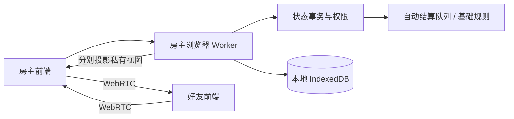

# 架构与同步

## 模块

前端只发送意图；Worker串行处理，内核在克隆状态上验证、提交，后端保存并广播各席位独立视图。没有远程游戏服务。静态托管只加载文件。

- `engine.js`：房间、选将、状态、权限、手动移动、迁移和投影。
- `rules.js`：自动队列、无懈链、杀闪/决斗/借刀/火攻/五谷响应、伤害/濒死/死亡、判定、拼点、回合。
- `primitives.js`：随机、洗牌、距离、基础技能/装备、卡牌成本。
- `worker.js`：串行执行、去重、存档、撤销和每连接席位绑定。

## 同步与版本

当前 `SCHEMA=2`、`PROTOCOL=2`。命令含UUID和预期rev。每次成功变更递增版本；旧版本拒绝并发送新快照，玩家核对后重试。每席位同时最多一个待确认指令，10秒未确认请求同步，不自动重复操作。去重窗口2000项。撤销和恢复也增加rev。

DataChannel为有序可靠传输。每次发送完整的可见快照，连接恢复后无需补增量事件。v1存档迁移为标准牌堆的手动模式，保留所有旧牌区；新旧联机协议不混用，双方刷新网页。

## 私有数据

完整状态只在房主Worker与IndexedDB：牌堆顺序、每人手牌、隐藏身份、席位token、私看区、五选一候选、拼点提交牌与自动队列。

`project()`显式列出可发送字段：自己的手牌、身份、候选与私看牌；他人仅有手牌张数；公共区域、已公开身份、日志和当前响应可见。拼点提交只公开哪些席位已选择，双方提交后才公开两张牌。不得把完整状态展开后删几个字段当作投影。

每个好友通过独立通道握手。token为随机凭据，保存在该房间的sessionStorage；开局后未知token不能加入，原token可重连。网络payload不指定actor，actor由Worker的通道绑定决定。新连接使用同一token会取代旧连接。

网络消息只能进入join/action/sync，不允许调用本机导出、恢复、撤销或演练控制接口。房主设备本身是可信权威，Worker不是防房主作弊的安全隔离；恢复JSON含所有秘密。

## 自动结算

`rules.pending`记录当前待响应，`rules.queue`为后续效果。对应玩家提交或放弃后继续队列；无懈窗口由全体存活玩家分别决定，无超时猜测。反无懈重开本轮放弃记录并翻转抵消状态。

延时锦囊先置判定区；到判定阶段才开启无懈窗口，未被抵消则翻牌，允许改判后确认结果。多个延时按置入倒序结算。

拼点提交牌移到隐藏`commits`区域，计入卡牌守恒；取消时退还。其他结算实体牌留在公开结算区，结束后弃置。五谷候选也计入公共区，不能获得不属于此次五谷的牌。

濒死暂停队列，按行动顺序求桃；自己可用酒自救。无人救援后确认死亡、弃置个人牌区、计算击杀奖惩和胜利。属性伤害传导后重置铁索，分别应用防具。

复杂武将的觉醒、限定、伤害触发、额外回合等没有通用自动实现，不根据技能名称臆测全部行为。已支持的基础技能见README；后续可在rules层新增明确处理器。

## 纠正与持久化

手动移动与自由模式保留，自动事件进行中禁止干扰牌区。房主correct命令需原因：可中止、改体力/上限、改阶段与回合、横置、重置杀/酒计数、补牌。所有修正留日志。撤销保留30步，不能收回已公开信息。

完整恢复状态包含响应队列与隐藏拼点；IndexedDB保存最近主持的一桌。房主恢复后重新邀请各席位，没有自动迁主或多桌云存档。请勿同时从同一来源的多标签页主持。

## 网络边界

手动信令为gzip+Base64的SDP，含房间和邀请UUID，不是加密房间码。连接码需私下交换。STUN可选；受限NAT可能需要自配TURN，不能保证任意互联网环境无中继直连。

每消息最多512KiB，分片6000字符、最多90片、最多8个未完成重组，超30秒清除；接收重组后再检查字节数。发送使用缓冲水位背压，队列最多256片；房主每连接每秒最多20个消息。昵称、聊天与说明限制长度、渲染统一转义。没有音视频或摄像头/麦克风权限。
